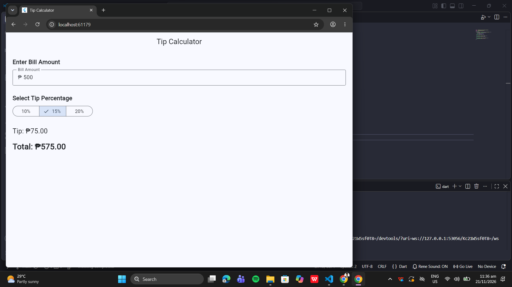

# Tip Calculator

**Developer:** Chryll Keith Geminez

## Description
A simple Flutter Tip Calculator application that
calculates the tip and total bill based on the
selected percentage.

## Features
- Enter bill amount
- Select 10%, 15%, or 20% tip
- Automatically calculate tip
- Display total amount
- Validate user input

## Technologies Used
- Flutter
- Dart
- VS Code

## Screenshot

